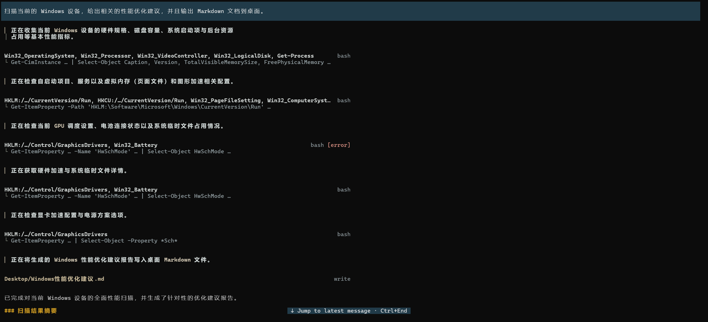

# Pi 中文过程展示 · pi-progress-zh

**少一点命令刷屏，多一点 Vibe Coding 的专注。**

`pi-progress-zh` 是一个面向中文使用者的 [Pi Agent CLI](https://pi.dev) 扩展。它把工具执行过程整理成简洁的一至两行摘要，配合中文过程说明，让你更容易跟上 Agent 的工作进展。

平时看清「正在处理什么」；需要核对时，再展开具体命令和结果。留在熟悉的终端聊天界面，减少繁杂执行信息对思路的干扰。



*实际使用截图：Windows Terminal 中的一次性能检查。图中的错误提示来自具体工具调用，插件保留其状态供检查。*

## 它带来了什么

- **执行过程更简洁。** 收起工具的长输出，突出文件、搜索对象或命令目标；复杂操作保留有用的命令片段，省略重复信息。
- **中文说明更容易跟上。** 主模型在关键节点说明当前进展，插件用连续导栏和清晰的文字层次帮助阅读。
- **详情随时可看。** 在支持鼠标交互的终端中，鼠标左键点击已完成的工具区域可展开或收起单条详情；`Ctrl+O` 可展开或收起全部工具详情。
- **失败仍然看得见。** 错误在摘要末尾保留状态提示，方便定位需要关注的操作。
- **沿用 Pi 原生体验。** 使用 Pi 公开扩展接口，不修改 Pi 本体或工具执行逻辑，原始参数、结果和消息记录保留。

它适合想关注任务进展和最终结果、又希望随时检查执行细节的 Pi CLI 使用者。

## 安装

需要先安装 Pi。本版在 **Pi `1.3.0`** 下验证。

从公开 GitHub 仓库安装：

```sh
pi install git:github.com/myhoodiao/pi-progress-zh
```

退出并重启 Pi，然后输入：

```text
/progress status
```

确认插件版本为 `0.9.0`，且工具摘要和中文说明接口已启用。

同一个插件只保留一种安装来源。如果已经安装了本地开发版，先用 `pi list` 核对来源，再移除旧来源，避免本地包和公开包重复加载。

## 使用

正常给 Pi 下达任务即可，无需每次额外输入指令。

| 操作 | 作用 |
| --- | --- |
| 正常对话 | 显示简洁工具摘要，并请求模型在关键节点给出中文说明 |
| 鼠标左键点击已完成的工具区域 | 展开或收起该条工具的原生详情，需要终端支持鼠标交互 |
| `Ctrl+O` | 展开或收起全部工具详情 |
| `/progress status` | 查看插件版本、当前 Pi 版本和功能状态 |

例如，在一次 Windows 性能检查中，摘要可以突出 `Win32_OperatingSystem`、`Win32_Processor` 或报告文件名。你不必一直阅读完整脚本和长输出；需要检查某一步时，再展开它的详情。

## 兼容范围与说明

- 当前组件测试：Pi `1.3.0` 下 **77 项通过**。离线终端回放覆盖 80、132、200 列，以及收起、展开、恢复和错误场景。测试不代表所有终端、模型和边界情况都已验证。
- 中文节点说明由当前主模型生成。插件会加入说明格式要求，但不能保证模型每次都遵守；普通正文和最终答复保持正常排版。
- 插件默认收起工具详情，并在界面隐藏原生 thinking 正文；原始 thinking 记录和模型上下文保留。插件不会为了过程说明另发模型请求。
- 摘要用于阅读，可能省略路径和参数。检查准确命令时请展开原生详情，不要把摘要当作完整命令直接执行。
- 图片服从 Pi 的原生设置。展开详情不会自动开启图片，也不能补回宿主已经截断的输出。
- 使用公开接口，不替换输入框、底栏或 Pi 自身的消息分隔。其他 Pi 版本可能存在布局差异；间距补齐只在已适配的 `1.3.0` 启用。
- Windows Terminal 是当前实际使用环境；其他平台和终端仍需要使用者验证。不兼容的公开接口会回退到原生显示。

## 更新与卸载

更新已安装的扩展：

```sh
pi update --extensions
```

卸载 GitHub 安装版：

```sh
pi remove git:github.com/myhoodiao/pi-progress-zh
```

更新或卸载后，退出并重启 Pi。

## 开发与反馈

实现集中在 `index.ts`。测试复用本机 managed Pi 的加载器，不需要额外安装另一份 Pi：

```sh
node --test test/render.test.mjs
```

欢迎在 [GitHub Issues](https://github.com/myhoodiao/pi-progress-zh/issues) 反馈。请附上 Pi 版本、终端名称和可复现步骤；截图和日志中请先移除不希望公开的内容。

MIT License · Copyright (c) 2026 myhoodiao

---

**English:** Compact tool summaries and Chinese progress commentary for Pi Agent CLI. Stay focused on vibe coding, then expand native command details when you need them. Tested with Pi 1.3.0.
